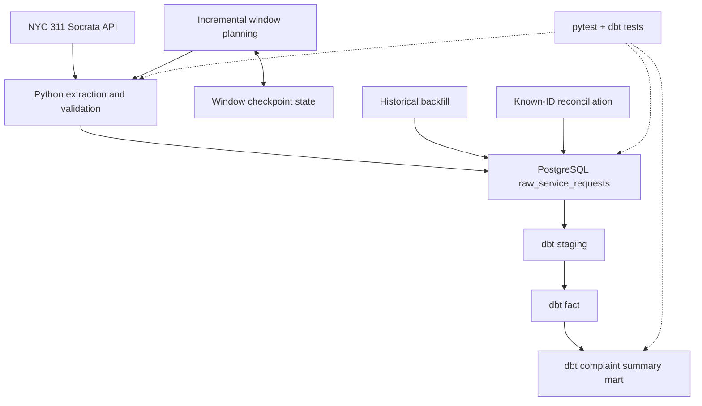

# ServicePulse NYC311

[](https://github.com/SantiagoCuello97/NYC-311-Data-Engineering/actions/workflows/ci.yml)

**A reproducible data engineering and analytics engineering project built with Python, PostgreSQL, dbt Core, and GitHub Actions.**

This project ingests public NYC 311 service request data, stores and processes records in PostgreSQL, and transforms them into analytics-ready models using dbt. It demonstrates core data engineering practices, including incremental ingestion, data quality validation, historical backfills, automated testing, and failure recovery.

## Project results

| Metric | Locally validated result |
| --- | ---: |
| Real NYC 311 requests stored | 51,743 |
| Duplicate request identifiers | 0 |
| Raw records reconciled with staging | 51,743 / 51,743 |
| Raw records reconciled with fact model | 51,743 / 51,743 |
| Summary mart groups | 253 |
| Python tests passing | 61 / 61 |
| dbt build results passing | 19 / 19 |
| dbt models | 3 |

These figures describe the locally validated dataset as of November 16, 2026. They are not live metrics and are not expected to match a fresh installation without loading the same source data.

The dbt build consists of three SQL view models and sixteen data tests.

## Technology stack

- **Python 3.12:** API extraction, validation, pagination, ingestion, and reconciliation.
- **NYC Open Data / Socrata API:** Public source of NYC 311 service requests.
- **PostgreSQL 17:** Persistent storage, UPSERT operations, transactional state, and analytical queries.
- **dbt Core + dbt-postgres:** Staging, fact modeling, aggregation, and data quality tests.
- **pytest:** Automated unit and PostgreSQL integration tests.
- **GitHub Actions:** Verified continuous integration using an ephemeral PostgreSQL service and synthetic test data.

## Architecture



The pipeline includes three complementary processing paths:

1. **Incremental ingestion:** Retrieves requests in bounded update-time windows, validates source counts and pagination, applies UPSERT operations, and advances the completed-window checkpoint transactionally.
2. **Historical backfill:** Loads bounded creation-date ranges in pages, commits completed batches, and supports recovery from an interrupted run using a database-derived keyset cursor.
3. **Known-ID reconciliation:** Re-fetches selected existing requests and distinguishes business-field changes from timestamp-only changes. Before applying updates, it re-reads and locks the corresponding database records.

The historical backfill and known-ID reconciliation paths do not advance the regular incremental checkpoint.

## Data source and scope

The public source is the NYC 311 service requests dataset, accessed through the Socrata API:

https://data.cityofnewyork.us/resource/erm2-nwe9.json

The locally validated database contains 51,743 unique requests. It includes 50,000 historical records from a bounded portion of October 1–7, 2026, in addition to 1,743 previously ingested requests.

This is a **purposefully bounded sample**, not the complete NYC 311 history. Metrics produced from it should not be interpreted as representative of all New York City service requests.

Source data may be incomplete, inconsistent, corrected, or updated after ingestion. This project does not guarantee that the upstream public records are error-free.

## PostgreSQL data model

The initial database schema is defined in:

- `sql/001_init.sql`
- `sql/002_sync_state.sql`
- `sql/003_window_checkpoint.sql`

The main operational objects include:

| Object | Purpose |
| --- | --- |
| `public.raw_service_requests` | Persisted source requests and source payloads |
| `public.ingestion_runs` | Recorded incremental ingestion executions |
| `public.sync_state` | Legacy ingestion watermark state |
| `public.window_sync_state` | Completed incremental-window checkpoint |

The database uses the NYC 311 `unique_key` as the logical request identifier.

### dbt transformation layers

| Model | Purpose |
| --- | --- |
| `stg_service_requests` | Standardizes source fields for downstream analysis |
| `fct_service_requests` | Adds request status and resolution-time indicators |
| `mart_complaint_summary` | Aggregates requests by month, agency, and complaint type |

The fact model includes indicators for closed requests, invalid date pairs, and measurable resolution durations.

The summary model provides request volumes and resolution-related measures for analytics.

## Reliability and engineering decisions

### Keyset pagination

Rather than relying exclusively on offset-based retrieval, the project uses ordered keys to navigate bounded source windows.

The extraction logic checks ordering, duplicate identifiers, and window constraints to detect inconsistent responses.

### Idempotent UPSERT

Records are keyed by their source request identifier. Reprocessing a previously loaded page does not create duplicate logical requests.

### Transactional checkpoints

The incremental runner keeps database updates and completed-window progress coordinated. A failed window must not be treated as successfully completed.

### API error recovery

Network interruptions, timeouts, and transient HTTP failures are handled with bounded retries.

During the historical ingestion exercise, an interrupted 50,000-record load was resumed from the last confirmed data position. The process ultimately loaded all 50,000 historical records.

### Mutable source records

NYC 311 records can change after they have been ingested. In the observed sample, five existing records received newer source-update timestamps without changes to the business payload stored by this project.

Historical reconciliation therefore uses stable request identifiers in addition to time-window extraction. The controlled five-record reconciliation was successfully committed and verified without changing the incremental checkpoint or deleting records.

## Getting started

### Prerequisites

- Python 3.12
- PostgreSQL 17 or a compatible PostgreSQL version
- Git
- Access to the public NYC 311 Socrata API

Clone the repository and enter the project directory.

```bash
git clone <YOUR-REPOSITORY-URL>
cd ServicePulse
```

Replace the placeholder URL after the repository is published.

### Install dependencies

```bash
python -m venv .venv
```

On Windows PowerShell:

```powershell
.\.venv\Scripts\python.exe -m pip install -r requirements.txt
```

On Linux or macOS:

```bash
.venv/bin/python -m pip install -r requirements.txt
```

### Configure PostgreSQL

Create an empty PostgreSQL database and a user with sufficient privileges to create the application tables and dbt analytics schema.

The application and dbt read database connection settings from these environment variables:

| Variable | Purpose |
| --- | --- |
| `DB_HOST` | PostgreSQL host |
| `DB_PORT` | PostgreSQL port |
| `DB_NAME` | Database name |
| `DB_USER` | Database username |
| `DB_PASSWORD` | Database password |

Copy `.env.example` to `.env`, then adjust the values for the local environment.

**Do not commit `.env` or any real credentials.**

Initialize the database schema by running these SQL scripts in order:

```text
sql/001_init.sql
sql/002_sync_state.sql
sql/003_window_checkpoint.sql
```

For a reproducible example of schema initialization with `psycopg`, see `.github/workflows/ci.yml`.

### Run tests

From the repository root:

```bash
python -m pytest -q tests
```

Some tests require a configured PostgreSQL database. The test suite is not entirely database-independent.

### Build analytics models

With the database configured:

```bash
dbt debug --project-dir dbt --profiles-dir dbt
dbt build --project-dir dbt --profiles-dir dbt
```

The `dbt build` command creates the analytical models and runs their configured data tests.

### Run pipeline components

The repository provides these entry points:

| Command | Function |
| --- | --- |
| `python src/run_planned_dry_run.py` | Plan and inspect an incremental window without applying changes |
| `python src/apply_next_window.py` | Apply the next eligible incremental window |
| `python src/historical_backfill.py --limit 500` | Run a bounded historical backfill |
| `python src/historical_backfill.py --limit 50000 --resume` | Resume a supported historical backfill from stored data |
| `python src/run_id_reconciliation.py` | Read-only reconciliation of five existing identifiers |
| `python src/apply_id_reconciliation.py` | Apply the controlled five-identifier reconciliation |

**Operational caution:** The historical backfill currently uses a predefined October 2026 interval and a bounded limit. The resume cursor assumes a continuous, consistently ordered historical selection. These scripts are demonstrations of the tested workflow, not a general-purpose production orchestration service.

Run state-changing operations only against a database you intend to modify.

## Testing and continuous integration

The project includes 61 passing Python tests covering ingestion, pagination, window planning, source count validation, checkpoint handling, rollback behavior, and record reconciliation.

The locally validated dbt build completed all 19 steps with no errors.

The GitHub Actions workflow is located at:

`.github/workflows/ci.yml`

It is configured to:

1. Set up Python 3.12.
2. Start an ephemeral PostgreSQL 17 service.
3. Install project dependencies.
4. Initialize the SQL schema.
5. Run the Python test suite.
6. Insert a small synthetic test dataset.
7. Run `dbt debug` and `dbt build`.
8. Verify analytical row counts.

The workflow uses synthetic data for CI. It does **not** upload the locally collected 51,743 real requests.

**CI status:** Verified on GitHub Actions (November 16, 2026). Workflow run #2 completed successfully: 61 Python tests passed, dbt build completed with PASS=19 and ERROR=0, and synthetic-data analytics reconciliation passed.

## Known limitations

- **Bounded dataset:** The validated historical sample is not the full NYC 311 dataset.
- **Source mutation:** Source-update timestamps can change independently of the selected business fields. A time-window-based extraction alone cannot guarantee complete historical change detection.
- **Reconciliation scope:** Controlled known-ID reconciliation has been validated on five real records; recurring full-dataset reconciliation is not implemented.
- **Historical resume assumptions:** Recovery derives a cursor from records already stored. It assumes the corresponding historical selection is continuous and consistently ordered.
- **Operational deployment:** No always-on scheduler, cloud-hosted production database, or service-level objective is included.
- **Source quality:** Public source records may contain erroneous or incomplete values. Data quality tests identify selected inconsistencies but do not guarantee perfect upstream data.

## Portfolio focus

This project demonstrates how to design, test, and document a small but realistic data platform:

- Reliable third-party API ingestion.
- Incremental processing with transactional state.
- Historical loading and recovery after partial failures.
- Data reconciliation for mutable upstream records.
- PostgreSQL data modeling and UPSERT semantics.
- dbt analytics transformation and data quality testing.
- Reproducible automated tests and CI configuration.

The emphasis is on **engineering correctness, recoverability, transparency, and maintainability**, rather than unnecessary infrastructure complexity.

## Data usage

ServicePulse uses publicly available NYC Open Data records. It is an independent educational and portfolio project and is not affiliated with or endorsed by NYC 311.

No local database dump, production credential, or private environment configuration is required to use the source code.